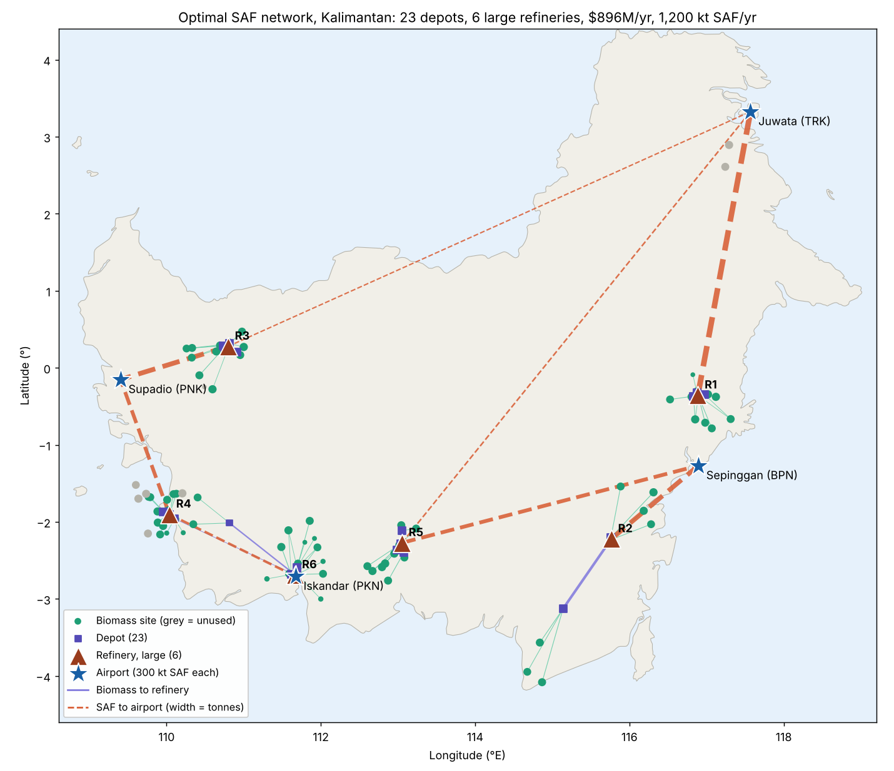

# SAF supply chain optimiser for Kalimantan (Airbus Challenge #3)

**The answer:** build **6 large refineries and 23 depots** to supply all four airports with 300 kt of SAF each (1,200 kt/yr), at a total of **$896M per year**, or about **$747 per tonne of SAF** before buying the biomass itself. Moving everything emits about **144 kt CO₂e a year: 2.8 g/MJ, about 3% of fossil jet fuel's life-cycle emissions**. Every facility has exact coordinates on land, a size, the flows through it, and the reason it sits there. For any forecast event (where, how big, how long, how bad), the planner gets **four alternative plans with pros and cons** (cheapest, lowest carbon, balanced, fair shares between airports) and chooses one. This works in a dashboard or in plain English through Claude.



---

## 1. Who this is for

**User:** a supply-chain planner at an Indonesian SAF producer deciding where to commit about $4.7B of CapEx.

**Status quo:** the planner works with consultant studies and spreadsheets. Each "what if" takes days, so few scenarios get tested before money is committed.

**Cost of getting it wrong:** a refinery in the wrong place locks in $76.5M/yr of fixed cost for 20 years.

**What changes for them:**
- The optimal network is computed in about 3 minutes.
- Any disruption scenario re-solves in about 1 second.
- Every number traces back to a solver run, and the planner approves or discards each scenario.

## 2. Results (organiser parameters)

### Refineries (all large, 1,087 kt/yr biomass intake)
| Refinery | Lat | Lon | Near | Biomass in (kt/yr) | Use | Supplies |
|---|---|---|---|---|---|---|
| R1 | -0.3549 | 116.8871 | Kutai Kartanegara, East Kalimantan | 986 | 91% | Juwata |
| R2 | -2.2202 | 115.7647 | Paser, East Kalimantan | 831 | 76% | Sepinggan |
| R3 | 0.2792 | 110.7979 | Sanggau, West Kalimantan | 1,087 | 100% | Supadio, Juwata |
| R4 | -1.9008 | 110.0366 | Ketapang, West Kalimantan | 1,087 | 100% | Iskandar, Supadio |
| R5 | -2.2711 | 113.0508 | Kotawaringin Timur, Central Kalimantan | 947 | 87% | Sepinggan, Juwata |
| R6 | -2.6878 | 111.6686 | Kotawaringin Barat, Central Kalimantan | 1,063 | 98% | Iskandar |

The 23 depots (21 large, 2 small) are in `results/facilities.csv`, and every flow with tonnes, km, cost and CO₂e is in `results/flows.csv`.

### Annual cost (`results/cost_breakdown.csv`)
| Component | $M/yr |
|---|---|
| CapEx ÷ 20 | 234.5 |
| Fixed OpEx (5% of CapEx) | 234.5 |
| Variable OpEx | 354.2 |
| Transport | 72.7 |
| **Total** | **895.9** |

### Other outputs
- **Airport supply:** each airport receives exactly its 300 kt (`results/airport_supply.csv`).
- **Biomass used:** 6,000 of 6,800 kt. The 800 kt left unused is all of Bulungan (189 kt), plus 555 kt in Ketapang and 56 kt in Sanggau.
- **Truck trips per year** (`results/truck_trips.csv`), using large trucks:

| Leg | Trips/yr | Trips/day |
|---|---|---|
| Farm → depot | 666,703 | ~1,827 |
| Depot → refinery | 200,003 | ~548 |
| Refinery → airport | 37,505 | ~103 |

  Juwata's last leg goes by barge at the same $/t·km.

### What the optimiser learned
- **Refining is about 92% of cost; transport is 8%.** So the model chooses fewer, larger refineries: they cost $55/t vs $60/t to run and less CapEx per tonne.
- **Juwata gets no refinery of its own,** and Bulungan's biomass next to it goes unused. Shipping finished SAF from R1, R3 and R5 is cheaper than a $76.5M/yr refinery for 189 kt of local biomass, because SAF is 5× lighter than the biomass it comes from.
- **Depot sizes follow throughput.** A large depot is $1/t cheaper to run but costs $225k/yr more in fixed cost, so it only pays above about 150 kt. Depots that end up handling less are switched to small automatically.
- **Depots end up beside refineries.** Depot→refinery hauls average 20 km, because that leg costs more per t·km ($0.12) than farm→depot ($0.10) and depots don't reduce mass.

## 3. Carbon footprint, event forecasts and plan options

### Carbon footprint (logistics)
| Leg | kt CO₂e/yr | Factor (kg CO₂e per t-km) | Source |
|---|---|---|---|
| Farm → depot | 60.0 | 0.242 | [GLEC v3.0, rigid truck 3.5–7.5 t, diesel](https://www.climatiq.io/data/emission-factor/abf431de-3ed9-43c4-ac9a-111ebae369ae) |
| Depot → refinery | 18.7 | 0.159 | [GLEC v2.0 Asia, rigid truck 12–20 t](https://www.climatiq.io/data/emission-factor/56ffe994-f35a-4a27-92ae-3628ca776ed2) |
| Refinery → airport | 65.6 | 0.159 (barge 0.010 for Juwata's last 30 km) | [GLEC v2.0, inland waterway convoy](https://www.climatiq.io/data/emission-factor/0e378f7e-20fd-4c80-bcfd-b3f591cd8968) |
| **Total** | **144.3** | | |

- **Intensity:** 120 kg CO₂e per tonne of SAF = **2.8 g/MJ**, about **3% of the 89 g/MJ fossil jet fuel baseline** ([ICAO CORSIA](https://www.icao.int/sites/default/files/sp-files/environmental-protection/CORSIA/Documents/CORSIA_Eligible_Fuels/ICAO%20document%2007%20-%20Methodology%20for%20Actual%20Life%20Cycle%20Emissions%20-%20June%202022.pdf)). Logistics barely dents SAF's climate benefit.
- **Every route** carries its own CO₂e in `results/flows.csv` and in the dashboard's "Routes & carbon" tab.
- **Not counted:** refinery process, farming and fuel combustion emissions. We assume jet fuel has 43 MJ/kg.
- **The factors are indicative.** The large-truck figure is a GLEC Asia default for gas-fuelled trucks; local diesel factors would refine it. All factors are editable settings.

### Event forecasts
The planner describes an event precisely:
- **Where:** a centre point (or district) and a radius in km
- **How bad:** % of biomass output lost, and whether depots and refineries inside the area are damaged
- **How long:** in weeks

The facilities stay fixed, and the solver re-routes all material. Impacts over the event are shown: SAF short, operating cost, replacement cost of missing SAF, and CO₂e. Refinery outages (partial or full) and demand surges at chosen airports work the same way.

**Events can happen at the same time.** Up to 3 events can be combined in the dashboard (any number through the Claude box or the code), and they can be stacked with:
- a fuel or haulage price change
- the Tarakan barge or port closing (Juwata cut off)
- road closures between specific facilities

Overlapping events multiply their losses on the same sites. They are treated as running together for the longest duration, which is a conservative simplification.

**Conversion rates used (organiser):** biomass → pre-processed feedstock at the depot 1:1 (no mass loss); feedstock → SAF 0.20 t per t. So 6,000 kt of biomass gives 1,200 kt of SAF.

### Plan options: the operator chooses
For every scenario the solver produces **four plans** on the same facilities:

| Plan | Priority |
|---|---|
| Cheapest | Lowest operating cost |
| Lowest carbon | Lowest CO₂e, while still delivering as much SAF as possible |
| Balanced | Cost plus a carbon price ($100/t CO₂e, our assumption) |
| Fair shares | Any shortfall spread in proportion to each airport's demand |

**Pros and cons are computed by rules**, by comparing the plans on cost, CO₂e, demand met, the worst-served airport and the longest haul. The operator approves one, and the choice is logged.

Example results (`results/plan_options.csv`):

| Scenario | Plan | Operating $M/yr | CO₂e kt/yr | Demand met | Worst airport |
|---|---|---|---|---|---|
| Base case | Cheapest | 427.0 | 144.3 | 100% | 100% |
| Base case | Lowest carbon | 427.1 | 144.1 | 100% | 100% |
| Flood, 60 km around Ketapang, −70%, facilities hit | Cheapest | 379.4 | 129.5 | 89% | **56% (Juwata)** |
| Same flood | Fair shares | 384.3 | 138.7 | 89% | **89% (all airports)** |

**What this shows:**
- In normal operation, cost and carbon point the same way: the lowest-carbon plan saves only about 0.2 kt CO₂e.
- In a disruption, there is a real trade-off. The cheapest plan cuts Juwata to 56% of its demand. Fair shares keeps every airport at 89%, for $4.9M/yr and 9 kt CO₂e/yr more. **That is a business decision, so the tool presents it and the planner makes it.**

## 4. How it works: the solver decides, the LLM explains

```
Organiser data ──► MILP (PuLP/CBC) ──► refine coordinates ──► on-land rule ──► sanity checks
                    which sites, which     Weiszfeld (Weber point)  snap offshore      10 checks
                    size, how much flows   per facility; accept     sites to nearest   (mass balance,
                    (min annual cost)      only if cost falls       land               capacity, demand, land)
                                                     │
                     Stage 2 LP: re-route flows through FIXED facilities for any scenario (about 1 s)
                                                     │
            Streamlit dashboard + Claude (claude-sonnet-5-5) what-if assistant
```

| Task | Done by | Why |
|---|---|---|
| Choosing sites and sizes, routing, all arithmetic | **MILP / LP solver** | Exact, with constraints that can be checked |
| Mass balances, capacities, demand, on-land | **Rule-based checks in code** | Never left to an LLM |
| Turning a question into scenario settings | **Claude** | Language understanding |
| Explaining a result | **Claude** | Told to quote only numbers from the solver output, cite the run ID, and never calculate |

**Model:**
- **Decisions:** open depot or refinery (binary, by size); tonnes on each farm→depot, depot→refinery and refinery→airport link.
- **Objective:** CapEx ÷ 20 + 5% of CapEx + variable OpEx by size + transport, per year (organiser basis).
- **Constraints:**
  - farm supply limits
  - depot and refinery intake capacity by size
  - mass balance (depots lose nothing; SAF out = 0.20 × biomass in)
  - each airport's demand of at least 300 kt
  - at most one size per site
- **Distance:** great-circle distance × 1.3.

**Getting exact coordinates:**
1. The MILP chooses among candidate sites: every farm for depots; 15 weighted k-means centres plus the 4 airports for refineries.
2. Each facility then moves to the point that minimises its own tonne-km cost (Weiszfeld). A move is kept only if total cost falls.
3. Any facility that ends up offshore is moved to the nearest land.
4. Any facility left with no throughput is removed.

## 5. Honest evaluation

### Tests and results
| Question | Test | Result |
|---|---|---|
| Is the network close to optimal? | Doubled refinery candidates (15 → 30) | Same 6 large refineries; cost within 0.3% ($898.1M vs $896.0M) |
| Does our 150 km farm→depot limit drive the answer? | 200 km and 250 km | $895.3M and $894.2M (≤ 0.2% change); same 6 refineries |
| Sensitive to the road factor? | 1.3 → 1.5 → 1.7 | $896.0M → $908.4M (+1.4%) → $919.2M (+2.6%); same 6 refineries, each moving ≤ 50 km |
| Better than a sensible plan without optimisation? | k-means plan: 20 large depots + 6 large refineries at cluster centres, on land, optimally routed | $901M/yr but **96 kt/yr of SAF undelivered (8%)**. With a 250 km limit: $949M/yr and still 27 kt short. **Ours meets 100% of demand at the lowest cost.** |
| Are the outputs physically consistent? | 10 automatic checks on every run | 10/10 pass in the base case and every scenario (`results/sanity_checks.csv`) |
| Same results in another environment? | Re-ran in Google Colab (earlier parameter set) | Identical cost and coordinates |

**Wording we stand behind:** optimal within about 1% over the candidate sites tested, not a proven global optimum.

### Where it is wrong, uncertain, or fails
1. **Little slack.** Refineries run at 76–100% of capacity and only 12% of the biomass is spare.
   - Losing **any one refinery leaves Juwata 113 kt short**.
   - A **Ketapang flood leaves 240 kt short** (`results/stress_test.csv`).
   - The design meets the brief, but a real operator would need a standby refinery (+$76.5M/yr), SAF storage at Juwata, or import contracts.
2. **The cheapest plan always shorts Juwata first,** because it is the most expensive to reach. We now offer a "fair shares" plan alongside it, but the choice of priorities is still the planner's.
3. **The organisers' data has an error: 13 of the 80 biomass coordinates are in the sea** (12 in Ketapang, 1 in Tanah Laut; checked against Natural Earth 1:10m).
   - We used the sites as given.
   - This pushed 4 facilities offshore. The on-land rule moved them 6–17 km inland, at a cost of under $0.1M/yr.
4. **Straight lines, not roads.** Great-circle × 1.3 is the organiser basis. Real Borneo roads, rivers and peatland would change individual routes; the road-factor test shows the design itself is stable.
5. **Not modelled:** the price of biomass, SAF storage (event impacts assume none), interest on CapEx, river barges (except Juwata), construction lead times, and non-logistics emissions.
6. **Event impacts are simplified:** annual rates × weeks ÷ 52. A real flood also has recovery time and storage buffers.

## 6. Trust and traceability
- **Assumptions are always visible** in the dashboard, each tagged *organiser* or *our assumption*. Our own assumptions:
  - farm→depot haul up to 150 km (tested above)
  - re-routing up to 300 km in a crisis
  - undelivered SAF priced at $3,000/t, used only to rank shortfalls in disruption scenarios
- **Every scenario run is numbered, logged and checked.** Run history and the 10 checks are shown in the dashboard.
- **Claude's suggested settings are shown before they are run** and validated against the real list of districts, refineries and airports. Anything else is rejected and not run.
- **The Claude box takes combined questions** (e.g. "a flood in Ketapang and a drought in Paser while R2 is half down and diesel is up 20%") and turns them into one scenario. It can only use the settings the solver has: floods, droughts or fires (place, radius, severity, weeks), refinery and depot outages, demand changes, fuel price, port and road closures.
- **Claude declines questions outside the model** instead of guessing, and the code also blocks any setting the model doesn't have. **Tested live:** asked *"which refinery or district, if lost, hurts most"*, it replied that this needs a ranking across many outages, while a scenario describes one disruption, and suggested asking about one named refinery at a time. That ranking lives in the Stress test tab and `results/stress_test.csv`.
- **The human decides:** every Claude scenario has **Approve** / **Discard** buttons.

### How to use it, and how not to (also a tab in the dashboard)
| ✅ Use it to | ⚠️ Don't use it to |
|---|---|
| Compare responses to one or several simultaneous disruptions before they happen | Decide where to build: scenarios re-route through the **fixed** facilities (re-run the design for that) |
| See the cost / carbon / airport trade-off, then choose and approve a plan | Plan day-to-day dispatch: results are yearly rates; events are scaled by weeks ÷ 52, with no storage or recovery |
| Size an event's impact (SAF short, extra cost, extra CO₂e) | Navigate real roads: distances are great-circle × 1.3 |
| Find weak points (Stress test tab, not the Ask box) | Answer price, weather, soil, labour or regulation questions: not in the model, and Claude should decline |
| Ask in plain English and check the settings Claude proposes | Treat CO₂e as a full life-cycle figure (logistics only), or let Claude choose the plan |

**The "Ask a what-if" box** handles combined questions within the solver's settings. It can't invent facilities, do arithmetic, choose a plan, or remember earlier questions, since each question is independent.

## 7. Impact
- **For the planner:** the network decision takes minutes instead of weeks, and the cost of each disruption is visible before committing $4.7B.
- **Against a sensible clustering plan:** ours delivers all 1,200 kt that plan misses 96 kt of, at about the same or lower cost.
- **Climate:** logistics adds 144 kt CO₂e/yr, only about 3% of fossil jet fuel's life-cycle emissions per MJ, so transport does not erode the SAF benefit. In disruptions the planner sees the carbon cost of each option before choosing.

## 8. How to run

**Dashboard** (Mac/Linux, Python 3.9+):
```
cd dashboard
python3 -m venv .venv && source .venv/bin/activate
pip install -r requirements.txt
export ANTHROPIC_API_KEY="sk-ant-..."    # only for the "Ask a what-if" box
streamlit run app.py
```

**Full re-optimisation:**
- **No install:** open `notebook/SAF_optimiser.ipynb` in Google Colab, choose Run all, and upload the two data files.
- **Command line:** `python model/saf_model.py all <biomass.xlsx> <Airport.dat.xlsx> results` (about 3 min). Then run `python model/baseline_kmeans.py ...` for the baseline.
- **Robustness tests:** environment variables `ROAD_FACTOR`, `MAX_FD_KM` and `N_REF_CAND`.

**Folder contents**
| Folder | Contents |
|---|---|
| `results/` | Facilities, flows, airport supply, cost breakdown, truck trips, stress test, sensitivity, checks, map |
| `model/` | Optimiser (`saf_model.py`), baseline, coastline (Natural Earth 1:10m) |
| `dashboard/` | Streamlit app with live scenarios and the Claude assistant |
| `notebook/` | Colab version, no installation |
| `data/` | Organiser files, unchanged |

**Stack:** Python, PuLP 2.x (CBC solver), scikit-learn, pandas, Streamlit, Plotly, Anthropic API.
